# HVAC Fittings – FreeCAD workbench

Flat patterns of sheet-metal duct fittings, HACO style:
**choose fitting → enter dimensions → flat pattern in the model space → check → export DXF.**

<p align="center"></p>

Everything is calculated on the **neutral surface** (no sheet thickness, no K-factor). The flat
pattern is the main result: closed sketches made of lines and arcs only, exported as a clean DXF
with layers for cutting, fold marks and annotations.

## ⬇ Download

**[Download HVACFittings.zip](https://github.com/M0ti0n/FC-SheetMetal-FITTINGS/raw/main/DOWNLOAD/HVACFittings.zip)** – latest version **v0.8.1**

Older versions: [DOWNLOAD/OLD](DOWNLOAD/OLD)

### Install

1. Unzip `HVACFittings.zip` into your FreeCAD **Mod** folder, so that you get `Mod/HVACFittings/`:

   | OS | Mod folder |
   |---|---|
   | Windows | `%APPDATA%\FreeCAD\Mod\` |
   | Linux | `~/.local/share/FreeCAD/Mod/` |
   | macOS | `~/Library/Application Support/FreeCAD/Mod/` |

   Not sure? `App.getUserAppDataDir()` in FreeCAD's Python console prints the folder that contains `Mod`.
2. Delete an older `HVACFittings` (or `HVACDevelopments`) folder there first.
3. Restart FreeCAD and pick **HVAC Fittings** in the workbench selector.

No extra Python packages are needed. Requires FreeCAD 0.21 or newer.

## Tools

| | Tool | Makes |
|:-:|---|---|
|  | [Segmented elbow](#segmented-elbow) | middle and end sections of a round segmented elbow |
|  | [Rectangular to round transition](#rectangular-to-round-transition) | off-centre rectangle → round, in one piece or split into short / long side parts |
|  | [Branch reducer](#branch-reducer) | round reducer (or straight pipe) with a round branch at any angle |
|  | [Flange](#flange) | flat ring flange with arc slots, whole or in 3 sections |
|  | [Threaded flange](#threaded-flange) | flat ring flange with drill & tap cross marks, whole or in 3 sections |
|  | [Screw flight](#screw-flight) | blank of one pitch of a screw conveyor flight + number of pieces |

All tools work the same way: the **task panel** shows a parameter diagram, *Flat Pattern Options*,
*Preview Options* (what is shown – Generate updates the model space) and *Export DXF*.
Reference dimensions, labels and annotations are **off by default**, so a fresh DXF only contains
what is cut and marked. Double-click a fitting in the tree to edit it again.

---

###  Segmented elbow

<table><tr>
<td width="320" valign="top">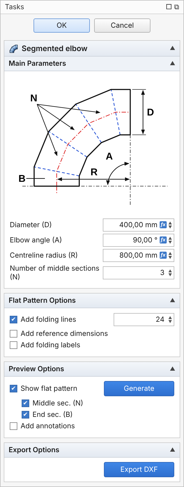</td>
<td valign="top">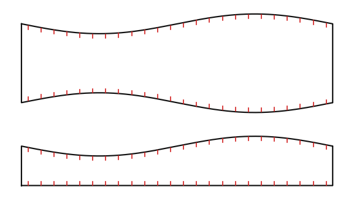<br>
<sub>End section ×2 (bottom) and middle section ×3, with fold marks</sub></td>
</tr></table>

| | |
|---|---|
| **D** | diameter (neutral) |
| **A** | elbow angle |
| **R** | centreline radius |
| **N** | number of **full middle sections** – the 2 end sections (**B**) are added automatically |

* Every end section is exactly half of a middle section, so one middle section spans `A / (N + 1)`
  (A 90°, N 3 → ½ + 3 + ½ pieces, 22.5° each).
* Development `h(φ) = (R + D/2·cos φ) · tan(θ/2)`; developed length `π·D`.
* Fold marks for the press brake: N fold lines around, drawn as two **15 mm** marks **2 mm** inside
  each cut edge (length and gap in the property editor).
* Seam on the side (mid-length seam) by default; *SeamPosition* = Side / Throat / Heel.

###  Rectangular to round transition

<table><tr>
<td width="320" valign="top">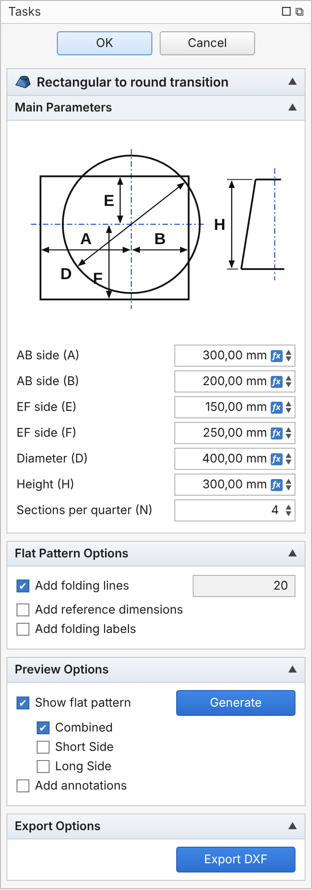</td>
<td valign="top">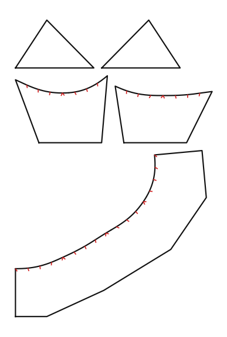<br>
<sub>Combined (bottom), Short Side (middle) and Long Side (top) all ticked</sub></td>
</tr></table>

| | |
|---|---|
| **A, B** | AB side: rectangle edge left / right of the round centre |
| **E, F** | EF side: rectangle edge above / below the round centre |
| **D** | diameter of the round end |
| **H** | height |
| **N** | sections per quarter of the round |

* Triangulation: every developed length equals its true 3D length, the round edge is exactly `π·D`.
* **Seam** on the longer rectangle side, straight down from the round (splits that side into A/B or E/F).
* Preview patterns, any combination: **Combined** (one piece), **Short Side** (short-side triangle with
  the corner parts bent on both sides = half of the round), **Long Side** (flat long-side triangle).
  Off-centre rectangles give two different short / long pieces; centred ones are drawn once ×2.
* Fold marks only at the round edge (the fold lines of a corner all meet in one point).

###  Branch reducer

<table><tr>
<td width="320" valign="top">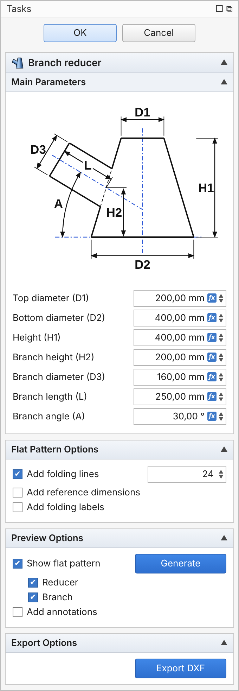</td>
<td valign="top">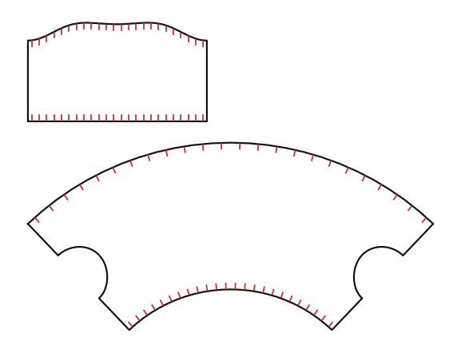<br>
<sub>Reducer with the two half-holes on its seam edges, branch above</sub></td>
</tr></table>

| | |
|---|---|
| **D1 / D2** | reducer diameter at the top / bottom (D1 = D2 → straight pipe: tee / lateral) |
| **H1** | reducer height |
| **H2** | height where the branch axis meets the reducer side |
| **D3** | branch diameter (up to D for an equal tee) |
| **L** | from that point along the branch axis to the branch end |
| **A** | branch angle above the horizontal (negative = pointing down) |

* Hole and branch edge come from the exact intersection of the two surfaces – the branch fits the hole.
* **Reducer seam** straight through the middle of the branch hole (two half-holes);
  **branch seam** on its shortest generator.

###  Flange

<table><tr>
<td width="320" valign="top">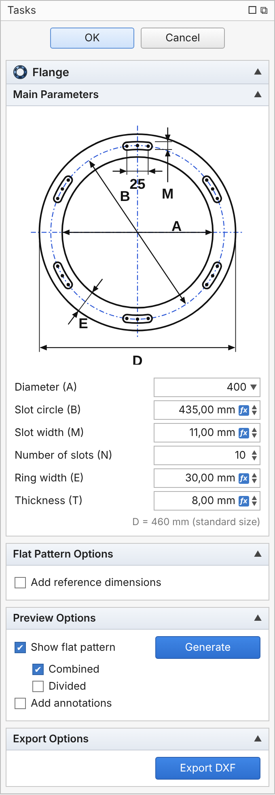</td>
<td valign="top">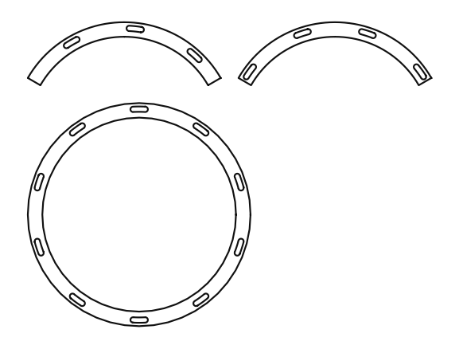<br>
<sub>A400: whole flange (Combined) and the sections (Divided): A ×2, B ×1</sub></td>
</tr></table>

| | |
|---|---|
| **A** | inner (nominal) diameter – editable list of **44 standard sizes** (A80 … A820) |
| **B** | diameter the slots lie on |
| **M** | slot width; slots are always **25 mm** between the end-hole centres |
| **N** | number of slots, equally spaced, the first one at the top |
| **E** | ring width → outer diameter **D = A + 2E** (information) |
| **T** | recommended thickness (information) |

* Picking a size fills in B, M, N, E, T from the table; any other A takes the values of the nearest
  smaller size. Everything can still be changed by hand.
* **Divided:** 3 sections of 120°. The first cut is midway between two slots, the others follow at
  +120° / +240°. N divisible by 3 → one section ×3; otherwise section **A ×2** (mirror images
  either side of the first cut) and **B ×1**. A80 and A100 are not divided.
* D and T are written only with reference dimensions or annotations on.

###  Threaded flange

<table><tr>
<td width="320" valign="top">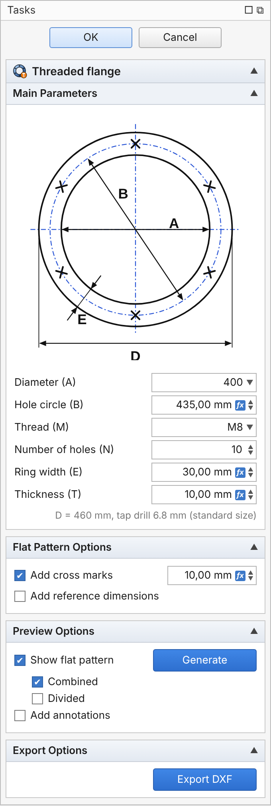</td>
<td valign="top">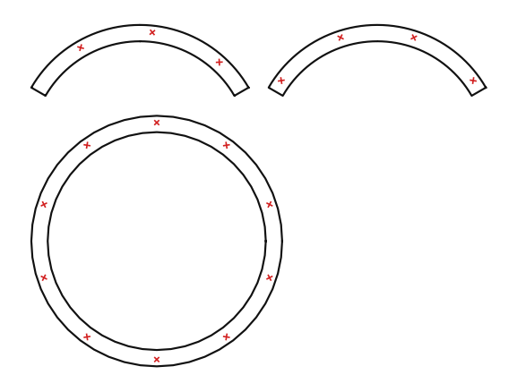<br>
<sub>A400 M8: X marks where the holes are drilled and tapped</sub></td>
</tr></table>

Same ring and the same **Combined / Divided** options as the flange, but each hole position gets an
**X cross mark** (own DXF layer **MARK**, mark size adjustable) instead of a slot.
**M** is the thread (M6 / M8 / M10 …): the panel shows the tap drill (M6 → 5.0, M8 → 6.8,
M10 → 8.5) and checks that the holes fit in the ring. 44 standard sizes from its own table.

###  Screw flight

<table><tr>
<td width="320" valign="top">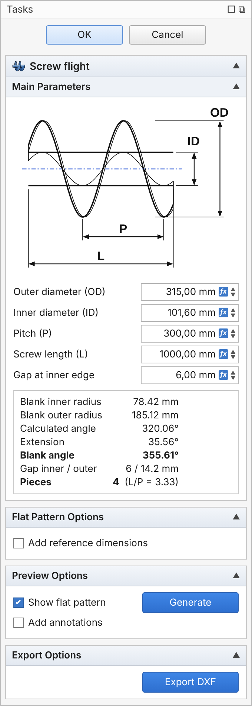</td>
<td valign="top">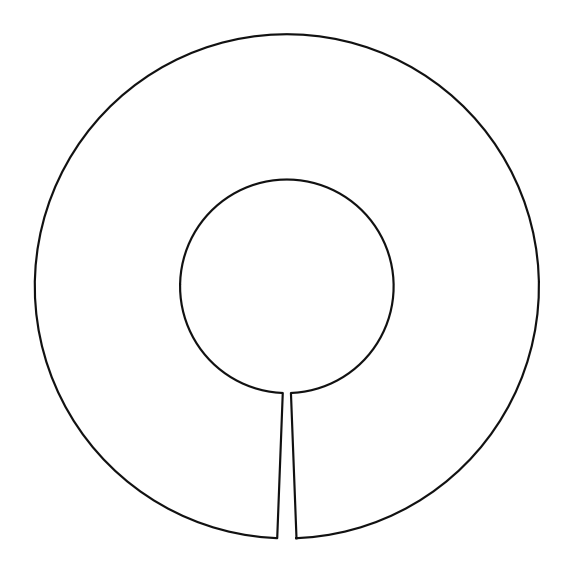<br>
<sub>Blank for one pitch, extended to a 6 mm gap at the inner edge</sub></td>
</tr></table>

| | |
|---|---|
| **OD / ID** | outer / inner diameter of the flight |
| **P** | pitch |
| **L** | screw length → **pieces = L / P rounded up** |
| **Gap** | gap left between the cut ends at the inner edge (default 6 mm) |

```
Li = √((π·ID)² + P²)   Lo = √((π·OD)² + P²)   h = (OD − ID) / 2
Ri = h·Li / (Lo − Li)  Ro = Ri + h            calculated angle = Li / Ri
```

* The calculated blank is less than 360°, so it is **extended until the cut ends are Gap mm apart**
  at the inner edge: blank angle = 360° − 2·asin(Gap / 2Ri). All results are shown live in the panel.
* Inner and outer edges have exactly the helix lengths; in between the blank is 1–4 % longer and
  is stretched when formed (a helicoid cannot be developed exactly).

---

## Output

**Tree:** each fitting holds its parameters; under it are closed **`*_Cut`** sketches (the cutting
contour), **`*_Folds`** / **`*_Marks`** sketches and an annotation object. The `_Cut` sketches can be
used as a SheetMetal base shape for a 3D check.

**DXF (R12)** – *Export DXF* writes exactly what is visible, read from the sketches (manual edits
are included):

| Layer | Content |
|---|---|
| CUT | cutting contours: closed polylines of lines + arcs (≤ 0.01 mm from the true curve) |
| FOLD | press-brake fold marks |
| MARK | scribe / punch marks (threaded-flange crosses) |
| REF | reference lines (heel / throat, triangulation, centre lines …) |
| DIM | reference dimensions (as lines) |
| TEXT | piece names, quantities, parameters, labels |

**No splines anywhere** – curves are fitted with arcs in the sketches too, so even FreeCAD's own
*File → Export* produces arcs.

## Development

```
InitGui.py / Init.py   workbench registration
hvacdev/geometry/      pure-Python development math, arc fitting, layouts (no FreeCAD)
hvacdev/dxf/           dependency-free DXF R12 writer
hvacdev/freecad/       feature objects, task panels, commands, export
resources/             icons and task-panel diagrams
tests/                 python tests/test_*.py   (no FreeCAD needed)
tools/                 generators for diagrams, icons, README images and the release zip
DOWNLOAD/              HVACFittings.zip (latest) and OLD/ (previous builds)
```

**New release:** raise `<version>` in `package.xml`, then run `python tools/release.py` – it moves
the current `DOWNLOAD/HVACFittings.zip` to `DOWNLOAD/OLD/HVACFittings-v<old version>.zip` and builds
the new one. README images: `python tools/make_panel_images.py` and `python tools/make_readme_images.py`.

Planned: simple concentric / eccentric reducer.

## License

LGPL-2.1-or-later, the same as FreeCAD.
